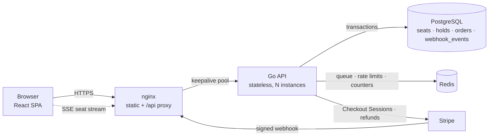

# Ticketracer

**A ticketing system that prevents overselling when thousands of people compete for limited seats.**

Fans enter a waiting room, pick seats on a live split-flap seat map, hold them for 10 minutes, and pay with Stripe (test mode). PostgreSQL decides every hold, so a seat can never be sold twice. Abandoned holds go back on sale automatically, and a payment webhook delivered five times still creates exactly one order. An operator dashboard shows the request pipeline live and includes a traffic simulator that tries to break all of this.

| | |
|---|---|
| Stack | React 19 + TypeScript (Vite) · Go 1.27 · PostgreSQL 17 · Redis 7 · Stripe (test mode) · Docker Compose |
| Proof | 22 Go tests (integration + config), 9 frontend tests, CI with `-race`, a measured 2,000-fan stampede with **0 oversold seats and 0 duplicate orders** |

---

## Quick start

Requirements: Docker Desktop. Go 1.27+ and Node 22+ are needed only to run the tests and the load test outside Docker.

```bash
cp .env.example .env          # then replace every "change-me" with a random value
docker compose up --build     # http://localhost:8080
```

- **Book:** open http://localhost:8080, then *Join the queue* → pick seats → *Hold* → *Pay*.
- **Dashboard:** http://localhost:8080/dashboard. Paste `ADMIN_TOKEN` from your `.env` and press *Release 2,000 fans*.
- Each browser tab is its own fan, so open two tabs to watch them compete for the same seats.

### Payments: demo mode or Stripe test mode

`PAYMENT_MODE=demo` (the default in `.env.example`) needs no Stripe account. The built-in checkout signs a Stripe-format `checkout.session.completed` event with `DEMO_WEBHOOK_SECRET` and posts it to the **same** `/api/webhooks/stripe` endpoint Stripe uses, so orders go through the production code path.

To use real Stripe Checkout in test mode:

1. In `.env`, set `STRIPE_SECRET_KEY=sk_test_…` (Dashboard → Developers → API keys) and `PAYMENT_MODE=stripe`.
2. Forward webhooks to your machine and copy the secret it prints into `STRIPE_WEBHOOK_SECRET`:
   ```bash
   stripe login
   stripe listen --forward-to localhost:8080/api/webhooks/stripe
   ```
3. Run `docker compose up -d --build api`, then pay with card `4242 4242 4242 4242`, any future date and any CVC.

The simulator keeps using signed demo payments in Stripe mode (admin-only), so load tests never call Stripe.

---

## Architecture



| Piece | What it does |
|---|---|
| `backend/internal/store` | All PostgreSQL access: the schema, the all-or-nothing reserve, expiry sweep, idempotent order completion, stats and invariants |
| `backend/internal/queue` | Redis waiting room (sorted set + atomic Lua admission), per-IP rate limit, shared counters |
| `backend/internal/pay` | Stripe Checkout + refunds (with idempotency keys), demo provider, webhook signature verification |
| `backend/internal/api` | HTTP handlers, middleware, Server-Sent Events seat stream, admin + simulator endpoints |
| `backend/internal/sim` | Traffic simulator used by both the dashboard and `cmd/loadtest`. It talks HTTP to the real API |
| `frontend/src` | Booking flow, confirmation, dashboard with the live pipeline visualizer |

### The guarantees and where they live

**1. A seat is never held or sold twice.** One statement in a transaction claims every requested seat or none:

```sql
WITH c AS (SELECT id FROM seats WHERE id = ANY($2) AND status = 'available'
           ORDER BY id FOR UPDATE SKIP LOCKED)
UPDATE seats s SET status = 'held', hold_id = $1 FROM c WHERE s.id = c.id
```

If fewer rows change than seats were requested, the transaction rolls back and the fan gets `409`. `SKIP LOCKED` makes a seat another transaction is claiming count as taken right away, so contention never queues up locks or deadlocks. A `CHECK` constraint ties `status` to `hold_id`, so a non-available seat always belongs to a hold. Removing the `status='available'` guard makes the race test fail with 10 winners for one seat, which shows the test can catch overselling.

**2. Expired holds go back on sale.** A sweeper (every 2 s, safe on any number of instances) expires overdue holds and frees their seats in one statement. A late payment never resurrects them.

**3. One payment creates exactly one order.** Webhook handling is one transaction:
1. `INSERT INTO webhook_events (id) … ON CONFLICT DO NOTHING`. A redelivered event stops here with `200`.
2. `SELECT … FROM holds … FOR UPDATE` serializes the payment against expiry.
3. `orders.hold_id UNIQUE` and `orders.payment_ref UNIQUE` are two more independent guards.
4. Any failure rolls back all of it and returns `500`, so Stripe retries.

**4. Money is never taken without seats.** The amount is checked against **our** database, never the webhook body. A payment for an expired hold or for the wrong amount becomes `refund_pending`. A background loop refunds it through Stripe with an idempotency key, so retries can never refund twice.

**5. A fair, steady waiting room.** Fans join a Redis sorted set in arrival order. Each second, exactly one API instance wins a `SET NX` slot and atomically admits the next N fans with a Lua script, so the admission rate stays fixed however many instances run.

**6. A live map without per-viewer database load.** Each API instance reads the 200 seat statuses once a second and pushes changes to every connected browser over SSE. That frame is 200 letters, one per seat. If the stream drops, the browser falls back to polling.

---

## Tests

```bash
# backend: integration tests against real Postgres + Redis (Docker Compose provides both)
docker compose up -d postgres redis
docker compose exec postgres psql -U ticketracer -c "CREATE DATABASE ticketracer_test"
export TEST_DATABASE_URL="postgres://ticketracer:<POSTGRES_PASSWORD>@localhost:5433/ticketracer_test?sslmode=disable"
export TEST_REDIS_URL="redis://:<REDIS_PASSWORD>@localhost:6379/15"
cd backend && go test -p 1 -count=1 ./...      # add -race on Linux/macOS

# frontend
cd frontend && npm ci && npm test && npm run build
```

What the backend suite covers:

| Test | Proves |
|---|---|
| `TestReserveRaceSingleSeat` | 100 concurrent fans, 1 seat, exactly 1 winner |
| `TestReserveAllOrNothing` / `TestReserveOverlappingRace` | No partial holds; no seat in two holds under 80 overlapping requests |
| `TestSweepReleasesExpiredHolds` | Expired seats return and can be booked again |
| `TestCompleteOrderIsIdempotent` | 5 concurrent deliveries plus a second event make 1 order |
| `TestLatePaymentIsRefunded` / `TestAmountMismatchIsRefunded` | Never sells seats someone else now holds; never fulfils a wrong amount |
| `TestSecondPaymentIsFlagged` | A different second payment for a paid hold is flagged for refund, not hidden as a duplicate |
| `TestDuplicateWebhooksCreateOneOrder` | The same thing end to end through HTTP and real signatures |
| `TestWebhookRejectsBadSignature` | Missing, garbage and wrong-secret signatures all get `400` and no order |
| `TestAdmitsInArrivalOrder` / `TestAdmitTickOncePerSecond` | FIFO admission at a constant rate across instances |
| `TestAdminRequiresToken`, `TestHoldRequiresAdmission`, `TestHoldIsPrivateToOwner`, `TestHoldValidation`, `TestDemoPayLockedDownInStripeMode` | Access control and input validation |
| `TestLoadRejectsWeakSecrets` | The server refuses to start with placeholder or short admin/webhook secrets |

> **Windows tip:** if `npm test` reports `Cannot read properties of undefined (reading 'config')`, your terminal opened the folder as lowercase `c:\…`. Run it from a path starting with `C:\`. This is a Vitest drive-letter quirk.

## Load test

```bash
docker compose up -d --build
cd backend && go run ./cmd/loadtest -url http://localhost:8080 -users 2000 -concurrency 200 -stampede
```

It resets the event, prints a Markdown report (throughput, latency percentiles, conflicts), and exits non-zero if any invariant fails.

## CI

`.github/workflows/ci.yml` runs on every push and pull request:
- **backend:** gofmt, `go vet`, tests with `-race` against Postgres and Redis service containers, govulncheck
- **frontend:** `npm test`, a typechecked production build, `npm audit` (high and above)
- **docker:** builds both images, boots the stack, and runs a 1,000-fan stampede that fails the build on any invariant violation

## Security notes

- Secrets come only from the environment. `.env` is gitignored, and `.env.example` holds placeholders only. **The API refuses to start** if `ADMIN_TOKEN` or `DEMO_WEBHOOK_SECRET` is still a `change-me` placeholder or shorter than 24 characters.
- **Admin API:** bearer token compared in constant time. With no token configured, nobody is admin.
- **Data stores:** Postgres and Redis are published on `127.0.0.1` only. Redis requires a password (`REDIS_PASSWORD`), and the Postgres container receives only its own `POSTGRES_*` settings, never the Stripe or admin secrets.
- **Webhooks:** Stripe signature verified, with Stripe's 5-minute replay window. Demo-signed events are accepted only while `DEMO_WEBHOOK_SECRET` is set; **unset it in production.**
- **Holds:** readable and payable only with the queue token that created them. Anyone else gets `404`, so hold ids can't be probed.
- **Input and abuse limits:**
  - JSON is strictly decoded.
  - 16 KB request bodies, 1 MB for webhooks.
  - 1–6 unique seats per hold.
  - Per-IP rate limits on joining the queue and on hold attempts; at most 10 checkout calls per hold per minute, so nobody can burn the Stripe account's API quota.
  - Malformed queue tokens are rejected before any Redis call.
  - nginx caps live seat streams at 8 per client IP.
  - Server read and write timeouts.
- **SQL:** parameterized everywhere. Error responses never include internal details.
- **Containers:** the API runs as non-root on a distroless image and isn't published on the host; only nginx is.
- **nginx:** CSP with no third-party origins (fonts are self-hosted), `X-Frame-Options DENY`, `nosniff`.
- **Personal data:** the only personal data stored is the email Stripe Checkout collects, kept on the order.

**Before a real deployment** (this V1 is set up as a local demo; these came out of the security audit and are deliberately not done yet):
- **Run the app over HTTPS.** Terminate TLS at nginx or a load balancer and add HSTS. Behind a load balancer, set `set_real_ip_from` so per-IP limits see the real client IP.
- **Turn off the demo tools.** Unset `DEMO_WEBHOOK_SECRET` in production: while it is set, demo-signed webhooks are accepted alongside Stripe's, and the admin simulator can create paid orders without payment. `POST /api/admin/reset` deletes every booking, so guard the admin token accordingly.
- **Cap seats per client.** Per-IP rate limits slow hoarding but do not cap the seats one IP holds at a time. That needs a `client_ip` column on `holds`.
- **Cap the waiting room.** Its length is unbounded; add a maximum length.
- **Harden containers and CI.**
  - Run nginx unprivileged (`nginxinc/nginx-unprivileged`).
  - Add `read_only`, `cap_drop`, `no-new-privileges` and memory limits in Compose.
  - Pin images by digest and CI actions by commit SHA.
  - Pin govulncheck and add a secret scanner such as gitleaks.
- **Set a data-retention policy.** Order emails are kept indefinitely.

Other V1 limits:
- There are no user accounts; the queue token is the fan's identity.
- There is one event and one seating layout.
- Refunds retry until they succeed, but nothing alerts on repeated failures.
- A second, *different* payment for an already-paid hold is logged as `second_payment` for a manual refund rather than refunded automatically. This can only happen across separate checkout sessions, because repeat clicks reuse one session.
- `X-Real-IP` is trusted because only nginx can reach the API.

## Project layout

```
backend/   cmd/api · cmd/loadtest · internal/{config,store,queue,pay,api,sim}
frontend/  src/{api.ts, lib/, components/, pages/} · nginx.conf
docker-compose.yml · .github/workflows/ci.yml
```
